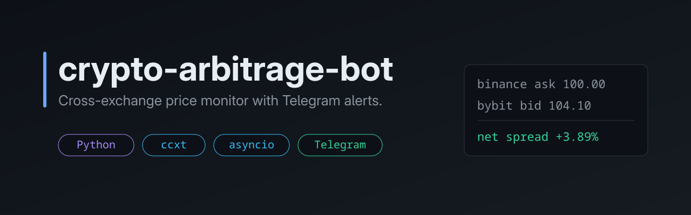
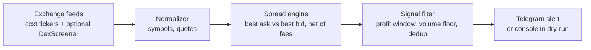

<p align="center">
  
</p>

[](https://github.com/HurbetAlex/crypto-arbitrage-bot/actions/workflows/ci.yml)
[](LICENSE)


A Python service that polls spot and futures prices on several exchanges, finds the best buy and sell venue for each common USDT pair, subtracts fees, and sends a Telegram alert when the net spread is large enough. It watches prices and reports them. **It never places orders** and has no code path that does.

## What it does

- Loads markets from Binance, Bybit and KuCoin (spot and futures, through [ccxt](https://github.com/ccxt/ccxt)) and keeps the USDT pairs listed on every configured venue.
- Normalizes symbol spellings (`BTCUSDT`, `BTC-USDT`, `BTC/USDT:USDT`) to `BTC/USDT`.
- For each pair, takes the lowest ask and the highest bid across venues and applies a per-venue fee to each leg.
- Filters signals: minimum and maximum net spread (the upper bound drops stale or broken quotes), optional 24h volume floor, and a cooldown so the same route is not alerted twice in a row.
- Sends an HTML alert to Telegram, or prints it to the console in dry-run mode (the default).
- Optionally adds DexScreener quotes. Off by default, because the same ticker on a DEX can be a different token.

Prices come from REST ticker polling, with blocking ccxt calls run in worker threads and all venues queried concurrently with `asyncio`. WebSocket feeds are on the roadmap.

## Architecture



## Quickstart

Requires Python 3.11+ and [uv](https://docs.astral.sh/uv/).

```bash
git clone https://github.com/HurbetAlex/crypto-arbitrage-bot.git
cd crypto-arbitrage-bot
uv sync
cp .env.example .env        # DRY_RUN=true by default: alerts print to the console
uv run arbitrage-monitor
```

To get Telegram alerts, create a bot with @BotFather, set `TELEGRAM_BOT_TOKEN` and `TELEGRAM_CHAT_ID` in `.env`, and set `DRY_RUN=false`. No exchange API keys are needed: only public market data is read.

## Configuration

All settings are environment variables (or a `.env` file), parsed by pydantic-settings.

| Variable | Default | Description |
|---|---|---|
| `TELEGRAM_BOT_TOKEN` | empty | Bot token from @BotFather |
| `TELEGRAM_CHAT_ID` | empty | Chat that receives alerts |
| `VENUES` | `binance:spot,binance:future,bybit:spot,bybit:future,kucoin:spot,kucoin:future` | Comma-separated `exchange:market` (any ccxt id; market is `spot` or `future`) |
| `ENABLE_DEX` | `false` | Include DexScreener quotes |
| `TRADE_VOLUME_USDT` | `1000` | Notional size used to compute coin amount and profit |
| `MIN_PROFIT_PCT` | `2.0` | Alert only above this net spread |
| `MAX_PROFIT_PCT` | `200.0` | Ignore spreads above this (likely bad data) |
| `MIN_VOLUME_USDT` | `0` | Minimum 24h quote volume on both venues |
| `ALERT_COOLDOWN_SECONDS` | `900` | Mute a repeated symbol and route for this long |
| `DEFAULT_FEE_RATE` | `0.001` | Fee per leg as a fraction (0.001 is 0.1%) |
| `DEX_FEE_RATE` | `0.003` | Fee per leg for DEX quotes |
| `FEE_OVERRIDES` | `{}` | Per-venue fee as JSON, e.g. `{"bybit:spot": 0.0008}` |
| `POLL_INTERVAL_SECONDS` | `10` | Pause between scan cycles |
| `REQUEST_TIMEOUT_MS` | `10000` | Per-request exchange timeout |
| `MAX_CYCLES` | `0` | `0` runs forever, `N` stops after N cycles |
| `DRY_RUN` | `true` | Print alerts instead of sending them to Telegram |

## Testing

```bash
uv sync --extra dev
uv run pytest -q     # 89 tests
uv run ruff check .
```

The tests cover the pure logic: spread with fees, symbol normalization, signal filters, alert formatting, dedup and cooldown, config validation, and the polling loop. Exchanges, DexScreener and Telegram are replaced with fakes and `httpx.MockTransport`, so the suite runs offline.

## Project structure

```
src/arbitrage_monitor/
  config.py    settings and venue parsing
  symbols.py   symbol normalization, common-market intersection
  sources.py   ccxt exchange source, DexScreener parser
  spread.py    best ask vs best bid, net of fees
  filters.py   profit window, volume floor, cooldown dedup
  alerts.py    alert text, Telegram and console notifiers
  monitor.py   polling loop
  __main__.py  entry point
tests/         offline unit tests
```

## Disclaimer

This is not financial advice. The tool only reads public prices and sends notifications; it does not trade and holds no exchange credentials. A displayed spread is a snapshot of top-of-book quotes. It ignores order book depth, slippage, withdrawal and deposit fees, transfer time, funding on futures, and rate limits, so a signal may not be executable. Futures and spot quotes are compared as if interchangeable, which they are not. Use it at your own risk.

## Roadmap

- WebSocket price feeds instead of REST polling.
- More DEX sources, with token address matching instead of ticker matching.
- Execution analytics: order book depth and slippage estimates per signal.
- Persisting signals for later analysis.

## License

MIT, see [LICENSE](LICENSE).
